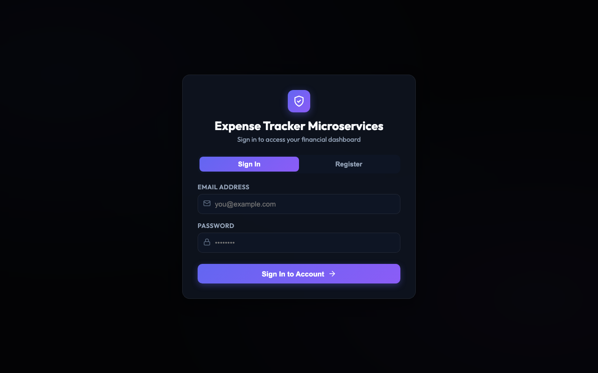
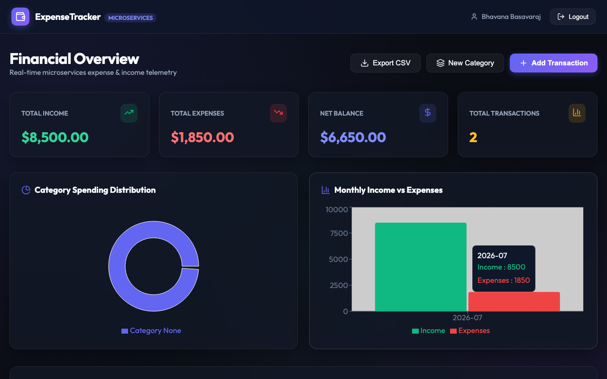
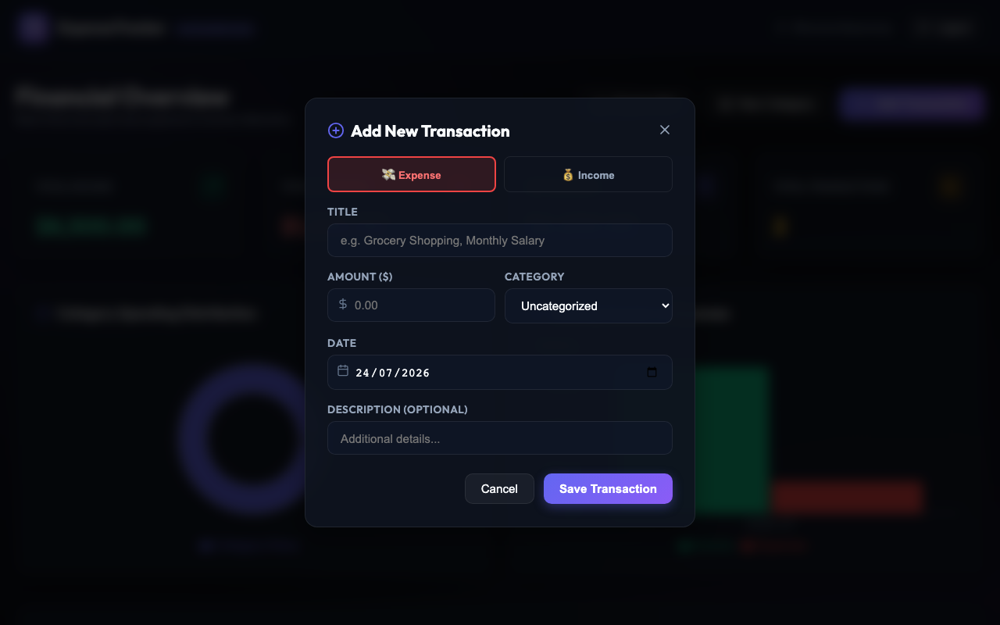

# 💰 Expense Tracker Microservices Platform

[](https://github.com/BhavanaBasavaraj/expense-tracker-microservices/actions/workflows/ci.yml)
[](./run_tests.sh)
[](./docker-compose.yml)
[](LICENSE)

A production-ready, cloud-native microservices application built with **FastAPI**, **PostgreSQL**, **Redis**, **Alembic**, and a **Vite / React / TypeScript** web dashboard. 

---

## 🎨 User Interface Screenshots

### 1. Authentication & Security Screen
Tabbed login and user registration modal with JWT bearer authentication.


### 2. Live Financial Overview Dashboard
Real-time financial telemetry, KPI summary cards, Recharts spending breakdown, and transaction history table.


### 3. Add Transaction Modal
Modal interface for recording income and expense entries with custom categories.


---

## 🚀 Key Microservices Architecture & Features

```
                              ┌───────────────────────┐
                              │  Vite React Frontend  │
                              │     (Port 3000)       │
                              └───────────┬───────────┘
                                          │
                                          ▼
                              ┌───────────────────────┐
                              │      API Gateway      │
                              │     (Port 8000)       │
                              └─────┬─────┬─────┬─────┘
                                    │     │     │
            ┌───────────────────────┼─────┴─────┼───────────────────────┐
            │                       │           │                       │
            ▼                       ▼           ▼                       ▼
 ┌─────────────────────┐ ┌───────────────────┐ ┌───────────────────┐ ┌────────────────────┐
 │    Auth Service     │ │  Expense Service  │ │ Category Service  │ │ Analytics Service  │
 │     (Port 8001)     │ │    (Port 8002)    │ │    (Port 8003)    │ │    (Port 8004)     │
 └──────────┬──────────┘ └─────────┬─────────┘ └─────────┬─────────┘ └────────────────────┘
            │                      │                     │
            └──────────────────────┼─────────────────────┘
                                   ▼
                        ┌─────────────────────┐
                        │ PostgreSQL Database │
                        │     (Port 5433)     │
                        └─────────────────────┘
```

1. **Centralized Gateway Authentication:**
   - The **API Gateway (`port 8000`)** is the only component that verifies JWTs. It strips any client-supplied `X-User-ID`, `X-User-Email`, `X-Internal-Key` and `Authorization` headers, then forwards the verified identity plus a shared `X-Internal-Key`.
   - Expense, category and analytics services trust identity headers **only** when they arrive with that key (compared in constant time; they fail closed if it is unset). They never call the auth service, so a request costs zero inter-service auth round-trips.
   - Defence in depth: the internal services are not published to the host in `docker-compose.yml`, and the tests assert that forged headers, wrong keys and bare bearer tokens are rejected.

2. **Database Migrations:**
   - Schema migrations managed via **Alembic** for `auth-service`, `expense-service`, and `category-service`; entrypoint scripts run `alembic upgrade head` on startup.
   - Tests apply the migrations, assert the resulting schema, fail if the SQLAlchemy models drift from the migrations, and check that downgrade removes everything.

3. **Rate Limiting:**
   - `slowapi` limits authentication endpoints to `10 req/min` with counters stored in **Redis**, so limits hold across gateway instances.
   - The gateway refuses to start if Redis is configured but unreachable (there is deliberately no silent in-memory fallback), and `/health` reports Redis status.

4. **Modern Frontend Web Application:**
   - **React 18 + Vite 5 + TypeScript** web application styled with glassmorphism design system.
   - Recharts visual charts for category spending breakdown & monthly income vs expenses.
   - One-click CSV financial log exports.

5. **Hardened Unprivileged Docker Containers:**
   - The five Python services use 2-stage builds and run as non-root `appuser` (uid 10001). The frontend image is multi-stage but serves via stock nginx (root).

---

## 🛠 Prerequisites & Local Setup

### Running with Docker Compose (Recommended)

```bash
cp .env.example .env        # then set real values (openssl rand -hex 32)
docker compose up --build
```

Without a `.env`, compose falls back to throwaway development defaults. Never deploy with those.

Reachable from the host:
- 🌐 **Web Dashboard:** `http://localhost:3000`
- ⚙️ **API Gateway:** `http://localhost:8000`
- 🗄️ Postgres `127.0.0.1:5433` and Redis `127.0.0.1:6379` (loopback only, for debugging)

The auth, expense, category and analytics services are only reachable inside the Docker network, through the gateway.

With the stack running, `./scripts/smoke_test.sh` registers two users and checks the full flow, including tenant isolation and forged-header rejection.

---

## 🧪 Testing & Code Coverage

### Backend (pytest)

```bash
pip install -r auth-service/requirements.txt -r expense-service/requirements.txt \
            -r category-service/requirements.txt -r analytics-service/requirements.txt \
            -r api-gateway/requirements.txt -r requirements-dev.txt
./run_tests.sh                                   # add REDIS_TEST_URL=redis://localhost:6379/15 for the real-Redis test
```

`run_tests.sh` fails if any service drops below **95%** line coverage. GitHub Actions (`.github/workflows/ci.yml`) runs the same script plus the frontend tests/build and a full `docker compose` smoke test on every push and pull request.

Beyond happy paths, the suites check: cross-user read/update/delete isolation, request-body ownership spoofing, forged identity headers, wrong-secret / `alg=none` / expired JWTs, the 429 after 10 auth requests, and a real Redis round-trip.

### Running Frontend Component Tests

```bash
cd frontend
npm test
```

---

## 📡 API Endpoints Summary

| Service | Method | Path | Description |
| :--- | :--- | :--- | :--- |
| **Gateway / Auth** | `POST` | `/auth/register` | User registration |
| **Gateway / Auth** | `POST` | `/auth/login` | Bearer JWT login |
| **Gateway / Auth** | `GET` | `/auth/me` | Get profile details |
| **Gateway / Expense** | `GET` | `/expenses/` | List user expenses |
| **Gateway / Expense** | `POST` | `/expenses/` | Create expense/income item |
| **Gateway / Expense** | `DELETE` | `/expenses/{id}` | Delete transaction item |
| **Gateway / Category** | `GET` | `/categories/` | List categories |
| **Gateway / Category** | `POST` | `/categories/` | Create custom category |
| **Gateway / Analytics**| `GET` | `/analytics/dashboard` | KPI Summary telemetry |
| **Gateway / Analytics**| `GET` | `/analytics/by-category`| Category spending breakdown |
| **Gateway / Analytics**| `GET` | `/analytics/monthly` | Monthly income vs expenses |

---

## 📄 License

Distributed under the MIT License.
