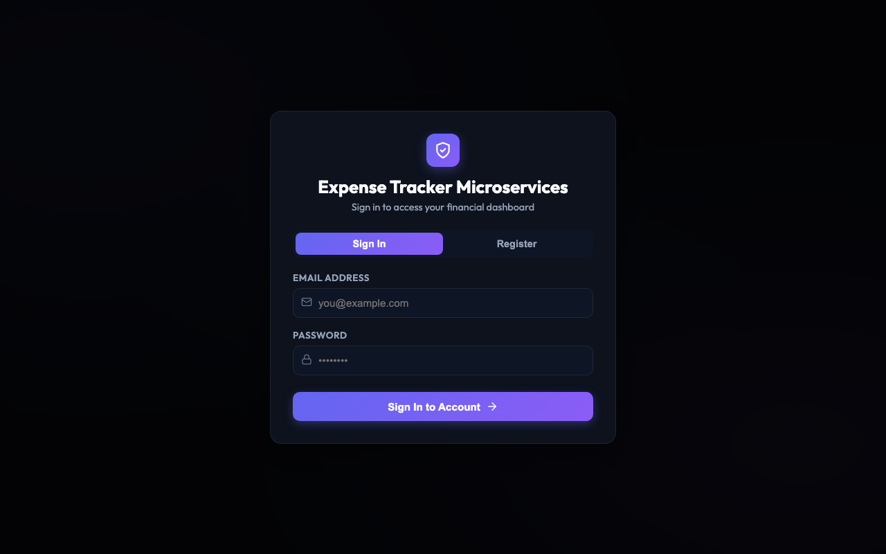
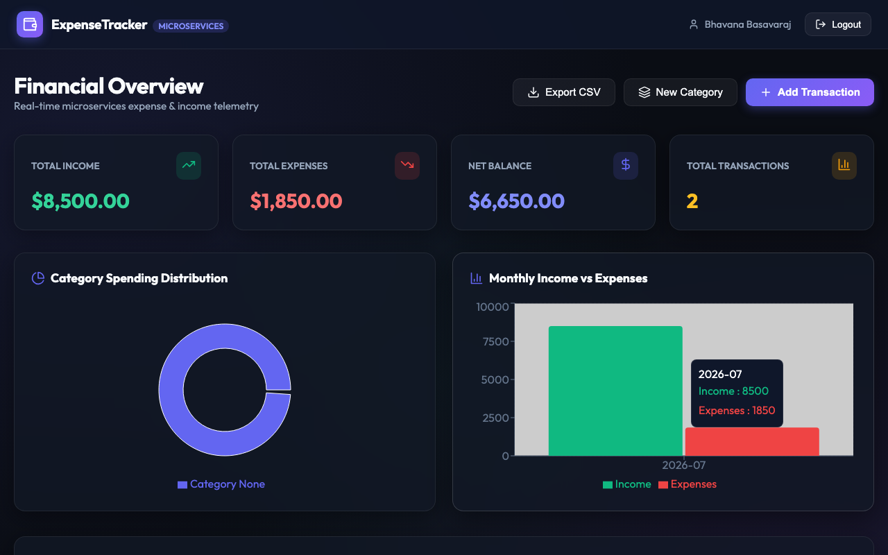
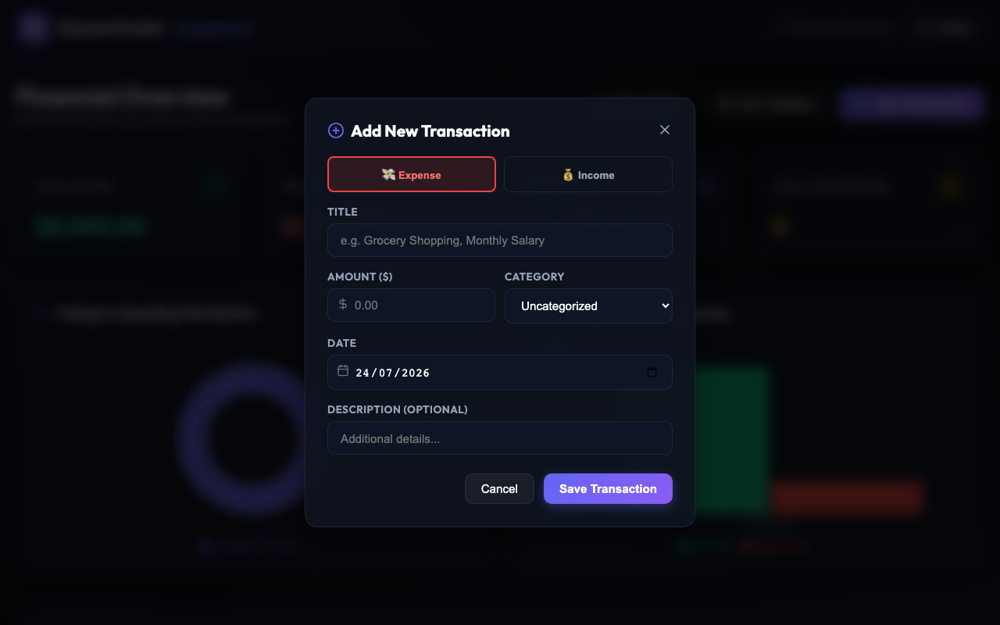

# 💰 Expense Tracker Microservices Platform

[](https://github.com/BhavanaBasavaraj/expense-tracker-microservices/actions/workflows/ci.yml)
[](./run_tests.sh)
[](./docker-compose.yml)

A personal finance tracker split into five **FastAPI** services behind a JWT-verifying API gateway, with **PostgreSQL**, **Redis**, **Alembic** migrations and a **React 18 / Vite / TypeScript** dashboard. The whole stack runs with one `docker compose up`.

---

## 🎨 Screenshots

### 1. Sign in / register
Tabbed login and registration modal. Login returns a JWT that the dashboard sends as a bearer token.


### 2. Dashboard
KPI cards (income, expenses, net balance, transaction count), a category spending pie chart, a monthly income-vs-expenses bar chart, and a searchable transaction table.


### 3. Add transaction
Modal for recording an income or expense entry against one of the user's categories.


---

## 🏗 Architecture

```
            Browser ──▶ React dashboard (nginx, host :3000)
                               │  Authorization: Bearer <JWT>
                               ▼
                 ┌───────────────────────────┐        ┌───────┐
                 │  API Gateway (host :8000) │───────▶│ Redis │  rate-limit counters
                 │  JWT verify · CORS · 429  │        └───────┘
                 └─────────────┬─────────────┘
                               │  X-User-ID + X-Internal-Key   (Docker network only below)
      ┌───────────────┬────────┴────────┬────────────────────┐
      ▼               ▼                 ▼                    ▼
 ┌─────────┐    ┌───────────┐    ┌────────────┐    ┌─────────────────┐
 │  Auth   │    │  Expense  │    │  Category  │    │    Analytics    │
 │  :8001  │    │   :8002   │    │   :8003    │    │      :8004      │
 └────┬────┘    └─────┬─────┘    └─────┬──────┘    └────────┬────────┘
      │               │   ▲            │                    │
      ▼               ▼   └────────────┼────────────────────┘
   auth_db       expense_db       category_db     Analytics has no database: it calls
      └───────────────┴────────────────┘          Expense (GET /expenses/) with the
        one PostgreSQL 14 instance                same internal key and aggregates.
        (host 127.0.0.1:5433)
```

| Service | Port | Responsibility | Storage |
| :--- | :--- | :--- | :--- |
| `api-gateway` | 8000 (published) | Single entry point. Verifies JWTs, strips spoofable headers, forwards identity, rate limits `/auth/*`, CORS, aggregated `/health` | Redis |
| `auth-service` | 8001 (internal) | Registration, login (bcrypt + JWT issue), profile lookup | `auth_db.users` |
| `expense-service` | 8002 (internal) | CRUD for income/expense transactions, scoped to the calling user | `expense_db.expenses` |
| `category-service` | 8003 (internal) | Create/list/delete per-user categories | `category_db.categories` |
| `analytics-service` | 8004 (internal) | Totals, per-category and per-month breakdowns, computed from the expense service's data | none |
| `frontend` | 3000 → 8080 (published) | React dashboard served by unprivileged nginx | browser `localStorage` (token) |

Each database-backed service owns its own database (database-per-service) on a shared Postgres instance. `init.sql` creates `expense_db` and `category_db` on first boot.

---

## 🚀 Features

### Gateway-centred authentication
- The **gateway is the only component that verifies JWTs** (HS256, shared `SECRET_KEY` with the auth service).
- Before proxying, it removes any client-supplied `X-User-ID`, `X-User-Email`, `X-Internal-Key` and `Authorization` headers, then adds the verified `X-User-ID` / `X-User-Email` plus a shared `X-Internal-Key`. Downstream services never see the raw token.
- Expense, category and analytics services accept identity headers **only** with a matching internal key (compared with `hmac.compare_digest`). If `INTERNAL_API_KEY` is unset they reject everything, and the gateway refuses to start without it.
- Internal services never call the auth service, so a request costs zero inter-service auth round-trips.
- Every query is filtered by the caller's `user_id`; the request body cannot set `user_id`.

### Rate limiting backed by Redis
- `slowapi` limits `/auth/*` to **10 requests/minute per client IP**, with counters stored in Redis so limits hold across gateway replicas.
- The gateway **refuses to start** if Redis is configured but unreachable (deliberately no silent in-memory fallback), and `/health` reports Redis status alongside each service.

### Database migrations
- Alembic migrations for `auth-service`, `expense-service` and `category-service`. Each container's entrypoint runs `alembic upgrade head` with bounded retries and exits non-zero if migrations still fail, so a service never starts on a bad schema.
- `alembic/env.py` reads `DATABASE_URL` from the environment (no hardcoded URL in `alembic.ini`).
- Tests apply the migrations, check the resulting schema, fail if the SQLAlchemy models drift from the migrations, and check that a downgrade removes everything.

### Input validation
- Passwords: 8–72 characters (72 bytes is bcrypt's real limit, so nothing is silently truncated). Emails validated with `email-validator`.
- Transactions: `type` must be `income` or `expense`; `amount` must be positive and finite; `date` must be a real calendar date in `YYYY-MM-DD`; blank titles are rejected (whitespace is stripped); title ≤ 200 chars, description ≤ 1000.
- Categories: `type` must be `income` or `expense`; blank names rejected.
- The dashboard turns FastAPI's 422 validation errors into readable messages.

### Browser security
- Gateway CORS uses an explicit allowlist (`CORS_ORIGINS`, default `http://localhost:3000,http://127.0.0.1:3000`), not `*`, with credentials off because the dashboard uses a bearer header rather than cookies. Internal services send no CORS headers.

### Dashboard (React 18 + Vite 5 + TypeScript)
- Login / registration with client-side hints.
- KPI cards from `/analytics/dashboard`.
- **Recharts** pie chart (spend by category) and bar chart (monthly income vs expenses).
- Transaction table with text search (title/description) and an income/expense filter.
- Add transactions and categories via modals; delete transactions from the table.
- **CSV export** of the currently filtered transactions.

### Containers
- The five Python services use two-stage builds on `python:3.12-slim` and run as non-root `appuser` (uid 10001).
- The dashboard is built with Node 20 and served by `nginxinc/nginx-unprivileged` (non-root, port 8080 in the container, 3000 on the host).
- Compose healthchecks on every service; the Postgres healthcheck queries all three databases so "healthy" means "ready to use", and services start in dependency order.
- Only the dashboard (3000) and gateway (8000) are published. Postgres and Redis are bound to `127.0.0.1` for local debugging only.

---

## 🛠 Running locally

### Docker Compose (recommended)

```bash
cp .env.example .env        # then set real values: openssl rand -hex 32
docker compose up --build
```

Without a `.env`, compose falls back to throwaway development defaults. Never deploy with those.

| What | Where |
| :--- | :--- |
| Web dashboard | http://localhost:3000 |
| API gateway | http://localhost:8000 (`/health` for status) |
| Postgres | `127.0.0.1:5433` (user `bhavana`) |
| Redis | `127.0.0.1:6379` |

The auth, expense, category and analytics services are reachable only inside the Docker network, through the gateway.

### Environment variables (`.env`)

| Variable | Used by | Purpose |
| :--- | :--- | :--- |
| `SECRET_KEY` | auth-service, api-gateway | Signs and verifies JWTs |
| `INTERNAL_API_KEY` | api-gateway, expense, category, analytics | Proves a request came through the gateway |
| `POSTGRES_PASSWORD` | postgres and all DB services | Password for the `bhavana` Postgres user |
| `CORS_ORIGINS` | api-gateway | Comma-separated browser origins allowed to call the gateway |

### Checking a running stack

```bash
./scripts/smoke_test.sh                               # registers two users and checks the full flow
CHECK_INTERNAL_PORTS_CLOSED=1 ./scripts/smoke_test.sh # also asserts ports 8001-8004 are not reachable
./run_curl_tests.sh                                   # verbose, step-by-step curl walkthrough of every endpoint group
```

The smoke test checks: all services and Redis healthy, register + login, create/read an expense, **user B cannot see user A's data**, analytics totals (gateway → analytics → expense), and 401s for no token, forged identity headers and a garbage JWT.

---

## 🧪 Testing

### Backend (pytest)

```bash
pip install -r auth-service/requirements.txt -r expense-service/requirements.txt \
            -r category-service/requirements.txt -r analytics-service/requirements.txt \
            -r api-gateway/requirements.txt -r requirements-dev.txt
./run_tests.sh
# Optional: REDIS_TEST_URL=redis://localhost:6379/15 ./run_tests.sh  (also runs the real-Redis test)
```

Unit tests use SQLite and an in-memory rate-limit store, so no Postgres or Redis is required. `run_tests.sh` fails if any service drops below **95% line coverage**.

| Suite | Tests | Coverage |
| :--- | :---: | :---: |
| Auth service (+ end-to-end auth flow) | 15 | 97% |
| Expense service | 26 | 100% |
| Category service | 18 | 100% |
| Analytics service | 10 | 100% |
| API gateway | 24 | 96% |
| Alembic migrations (3 services) | 3 | — |
| Gateway ↔ real Redis | 1 | runs when `REDIS_TEST_URL` is set |

Beyond happy paths, the suites check cross-user read/update/delete isolation, request-body ownership spoofing, forged identity headers, wrong/missing internal keys, fail-closed behaviour when no key is configured, wrong-secret / `alg=none` / expired JWTs, the 429 after 10 auth requests, startup refusal when Redis or the internal key is missing, CORS allow/deny, and validation edge cases (non-finite amounts, invalid dates, bad types).

### Frontend (Vitest + Testing Library)

```bash
cd frontend
npm ci
npm test          # 8 tests: API client error handling, auth modal, dashboard rendering
npm run build     # type-checks with tsc, then builds
```

### CI

GitHub Actions (`.github/workflows/ci.yml`) runs on every push to `main` and every pull request:
1. **Backend** — `./run_tests.sh` with a Redis service container (so the real-Redis test runs too).
2. **Frontend** — `npm ci`, `npm test`, `npm run build`.
3. **Stack smoke test** — `docker compose up --build --wait`, then `scripts/smoke_test.sh` with the internal-ports check; dumps logs on failure.

---

## 📡 API (via the gateway, `http://localhost:8000`)

All routes except `/auth/*`, `/health` and `/` require `Authorization: Bearer <token>`.

| Method | Path | Description |
| :--- | :--- | :--- |
| `POST` | `/auth/register` | Create a user (`email`, `first_name`, `last_name`, `password`) |
| `POST` | `/auth/login` | Form-encoded `username` (email) + `password` → `{access_token, token_type}` |
| `GET` | `/auth/me?token=<jwt>` | Current user's profile (token passed as a query parameter) |
| `GET` | `/auth/verify?token=<jwt>` | Validate a token and return its claims |
| `GET` | `/expenses/` | List the caller's transactions |
| `POST` | `/expenses/` | Create a transaction (`title`, `amount`, `type`, `date`, optional `category_id`, `description`) |
| `PUT` | `/expenses/{id}` | Replace a transaction (API only; no edit UI yet) |
| `DELETE` | `/expenses/{id}` | Delete a transaction |
| `GET` | `/categories/` | List the caller's categories |
| `POST` | `/categories/` | Create a category (`name`, `type`) |
| `DELETE` | `/categories/{id}` | Delete a category (API only; no UI yet) |
| `GET` | `/analytics/dashboard` | `total_income`, `total_expenses`, `net_balance`, `total_transactions` |
| `GET` | `/analytics/by-category` | `{category_id: {total, count}}` |
| `GET` | `/analytics/monthly` | `{YYYY-MM: {income, expenses}}` |
| `GET` | `/health` | Gateway status plus each service and Redis |

Auth endpoints are limited to 10 requests/minute per IP; the 11th returns `429`.

---

## ⚠️ Known limitations

- **Service-to-service trust is a shared secret, not mutual TLS.** Anyone holding `INTERNAL_API_KEY` can impersonate any user to the internal services. It is defence in depth on top of network isolation, not a substitute for mTLS or per-service token verification.
- **JWTs are 30-minute bearer tokens** with no refresh or revocation. The dashboard keeps the token in `localStorage` and signs the user out on any failed data load.
- **`/auth/me` takes the token as a query parameter**, so it can end up in access logs.
- **The dashboard's API URL is hardcoded** to `http://localhost:8000` in `frontend/src/api.ts`; deploying elsewhere needs a code change.
- **Analytics fetches every transaction for the user on each request** and aggregates in Python. Fine for a personal tracker, but not designed for large histories.
- **Uncategorised transactions** appear under the key `"None"` in `/analytics/by-category` (the `"uncategorized"` default is never reached because `category_id` is present but null).
- **No cross-service referential integrity.** Deleting a category does not touch expenses that reference it, and `category_id` on an expense is not checked against the category service.
- **Amounts are stored as floats** and dates as `YYYY-MM-DD` strings.
- **Services also call `Base.metadata.create_all()` on startup**, alongside Alembic. Harmless today (migrations run first), but it can mask a missing migration.
- **Secrets default to throwaway development values** when no `.env` exists.
- **No LICENSE file** is included, so the code is "all rights reserved" by default.
